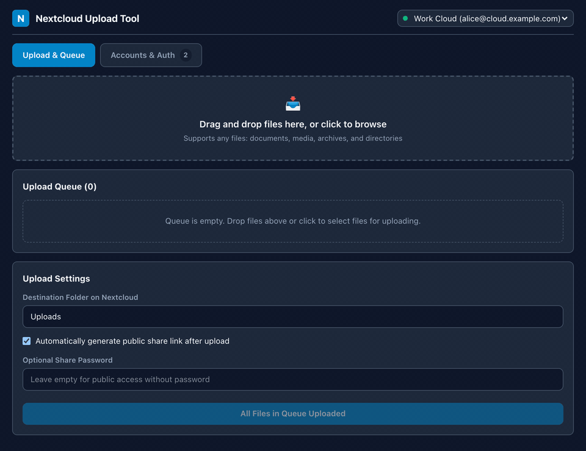
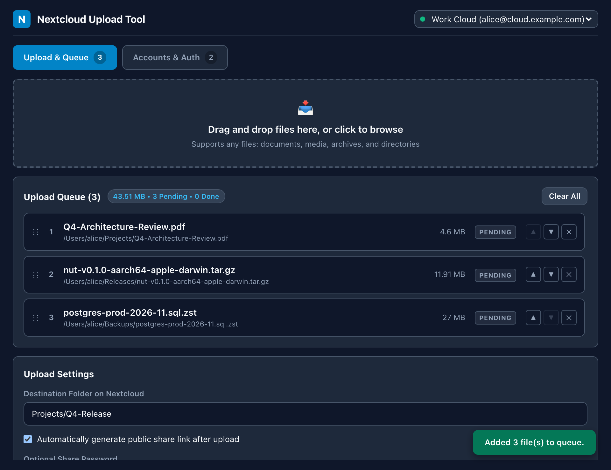
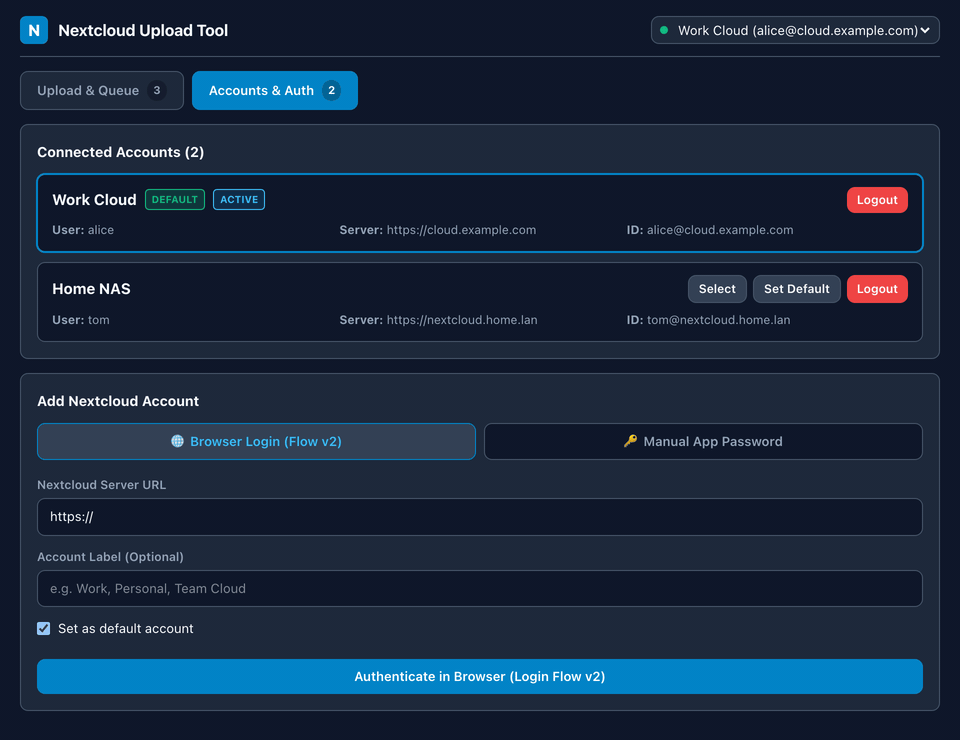
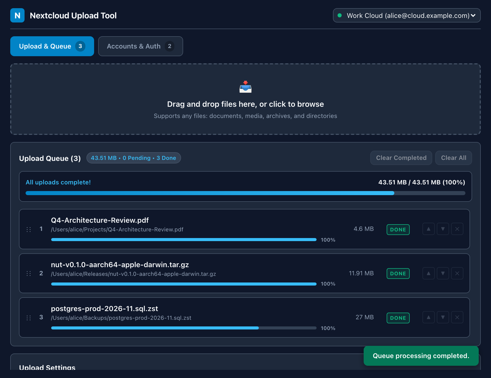
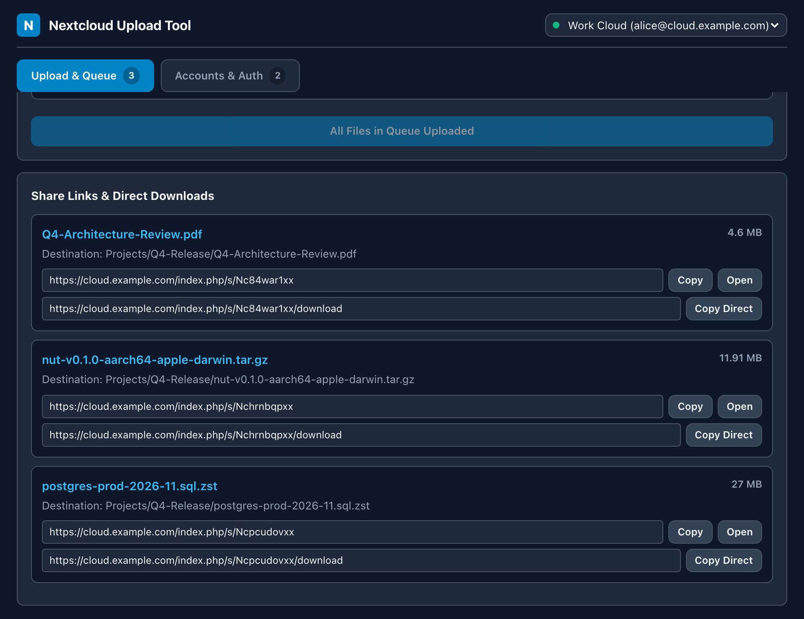

# GUI Desktop Application Guide

The **Nextcloud Upload Tool GUI** is a fast desktop application built with Tauri v2 and React 19, designed for streamlined file queuing, drag-and-drop uploads, public share creation, and multi-account management.

---

## 1. Interface Overview

The interface is structured into three primary sections:

1. **Header Bar**:
   - Displays the application branding.
   - **Account Switcher**: Quick-switch dropdown to select the target Nextcloud account for uploads.
   - **Navigation Tabs**: Toggle between **Upload & Queue** and **Accounts & Auth**.

2. **Upload & Queue Tab**:
   - **Drag & Drop Zone**: Visual target supporting OS file drops or manual system file browser selection.
   - **Queue List**: Per-file upload queue showing status badges (`PENDING`, `UPLOADING`, `DONE`, `ERROR`), live percentage, byte counters, and action buttons (`▲`, `▼`, `✕`, inline `↻ Retry`).
   - **Upload Settings**: Configure remote destination folder on Nextcloud (default: `Uploads`), toggle automatic public share generation, and set optional share link passwords.
   - **Share Links & Direct Downloads**: Displays generated public share URLs (`/index.php/s/<token>`) and direct download URLs (`/index.php/s/<token>/download`) with one-click **Copy**, **Open**, and **Copy Direct** actions.

3. **Accounts & Auth Tab**:
   - **Connected Accounts**: Interactive cards displaying connected usernames, server endpoints, custom labels, and active/default status badges.
   - **Browser Login (Login Flow v2)**: One-click interactive authorization opening your web browser with full support for 2FA and SSO.
   - **Manual App Password Entry**: Form for connecting with custom server URLs, usernames, and generated application tokens.

---

## 2. Step-by-Step Walkthrough

### Connecting Your First Account
1. Open the application and switch to the **Accounts & Auth** tab.
2. Enter your Nextcloud server URL (e.g. `https://cloud.example.com`) and an optional friendly label (e.g. `Work Cloud`).
3. Click **Authenticate in Browser (Login Flow v2)**.
4. Your default browser opens the authorization page. Click **Grant Access**.
5. The GUI automatically polls and securely stores your token in your operating system's native keychain.

### Uploading Files & Creating Share Links
1. Navigate to the **Upload & Queue** tab.
2. Drag and drop one or more files from Finder / Explorer / File Manager into the dropzone.
3. (Optional) Check **Automatically generate public share link after upload** and specify an **Optional Share Password** if needed.
4. Set the **Destination Folder on Nextcloud** (e.g. `Projects/Q4-Release` or `Uploads`).
5. Click **Upload Queue**.
6. Real-time progress bars update for both the overall batch and each individual file.

7. Once finished:
   - Click **Copy** to copy the public share URL to the clipboard.
   - Click **Copy Direct** to copy the raw direct-download URL.

### Managing Failed Uploads
- If any file fails (e.g. due to network interruption or server quota), an error badge is displayed with details.
- Click the inline **↻ Retry** button next to that item to re-attempt the upload immediately without resetting the queue.
